# Zakat — kalkulator & simulasi zakat sesuai Al-Qur'an dan Sunnah

Website statis untuk menghitung zakat menurut syariat Islam, dalam bahasa Indonesia
sehari-hari. Dibangun dengan Flavida Design System — saudara kandung
[waris](https://github.com/arnantoakbar/waris), kalkulator pembagian warisan.

Aturan zakat sudah baku dan tertutup: nisab ditetapkan dalam hadits sahih (85 gram emas,
595 gram perak, 5 wasaq panen, 40 kambing…), kadarnya pasti (2,5% · 5% · 10% · 20%),
penerimanya dibatasi QS At-Taubah 60 pada delapan golongan — dan tidak pernah berubah
sejak diturunkan. Yang membuat orang awam menunda bukan aturannya, tapi menerapkannya:
harta campuran tabungan-emas-cicilan, haul yang memakai tahun hijriah, syarat ternak yang
digembalakan. Website ini menutup celah itu. Bahkan UU 23/2011 Pasal 21 menyuruh muzaki
*menghitung sendiri kewajiban zakatnya* — alat ini dibuat persis untuk itu.

---

## Tampilannya

Semua tangkapan layar di bawah diambil dari aplikasi yang berjalan, bukan mockup.

### Halaman utama

Animasi demo berjalan sendiri di hero — satu kasus contoh dihitung dari nol sampai
selesai oleh mesin yang sama persis dengan yang dipakai pemakai, bukan angka karangan.

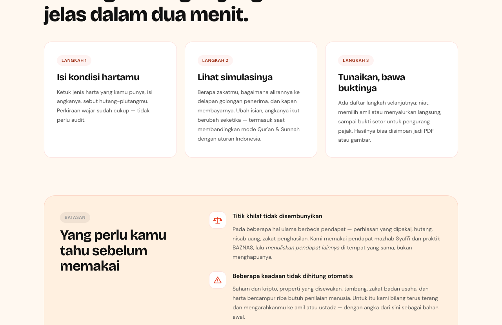

### Isian: pilih jenis harta, isi angkanya

Delapan jenis harta sebagai kartu — yang tidak dimiliki dilewati saja. Rumah tinggal dan
kendaraan pribadi sengaja tidak ada di daftar, karena memang tidak dizakati (HR Bukhari
1464), dan itu dijelaskan di tempatnya.

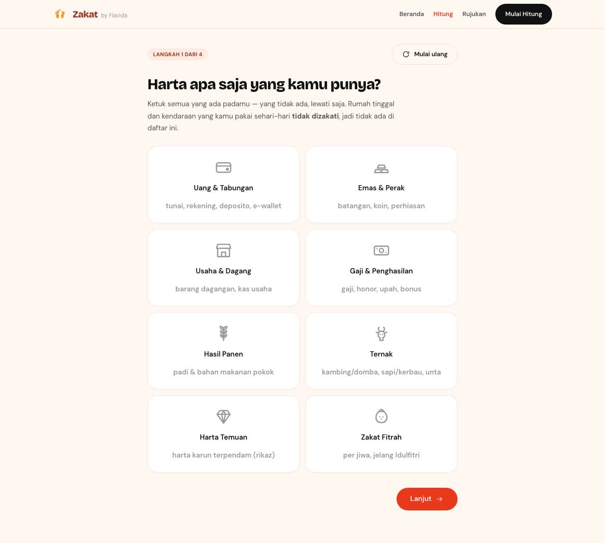

### Hasil dengan dalilnya

Total zakat, status per jenis harta beserta alasannya, dan saklar dua dasar hukum.
Mengubah isian mana pun menghitung ulang seketika.

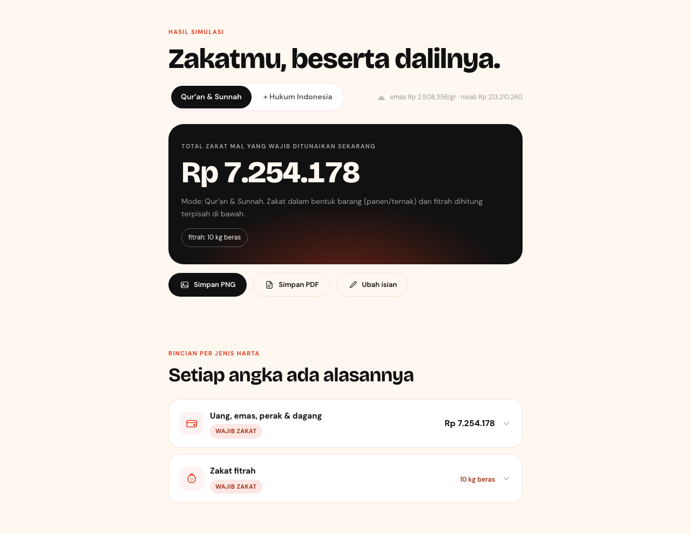

### Simulasi aliran harta

Rincian harta → dikurangi hutang jatuh tempo → dibandingkan ke nisab → kadarnya digambar
apa adanya: **1 dari 40 kotak** — bahasa haditsnya sendiri (rub'ul 'usyr). 39 kotak
lainnya tetap milik pemakai, dan justru menjadi bersih karena yang satu ditunaikan.

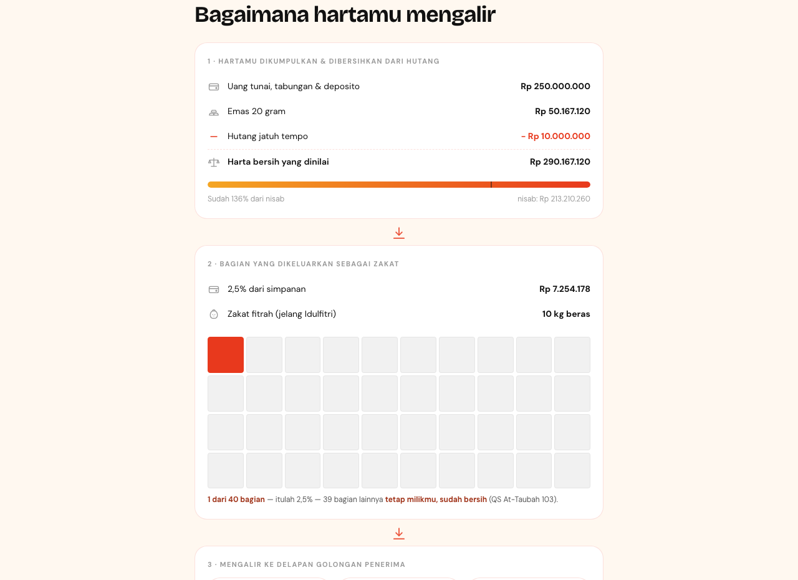

Lalu mengalir ke delapan golongan penerima. Ketuk golongan mana pun — ruasnya disorot di
dalam ayatnya, ayatnya tetap utuh.

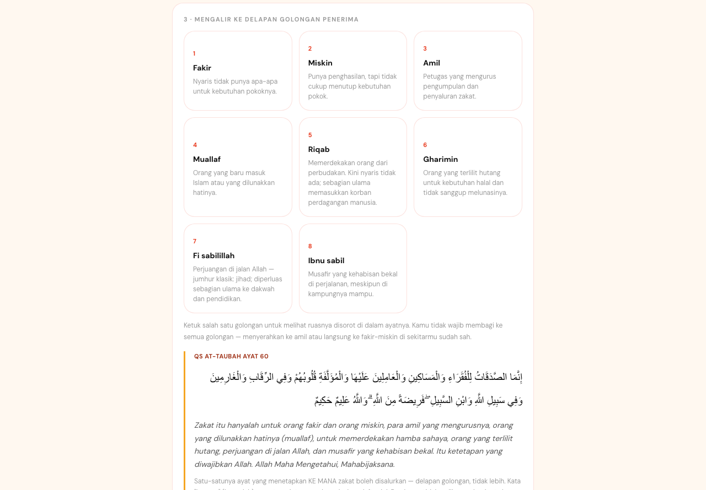

### Kapan membayarnya

Simpanan menunggu haul, panen dibayar di hari panen, fitrah sebelum shalat Id — diurutkan
sebagai garis waktu, lengkap dengan bolehnya membayar lebih awal (ta'jil).

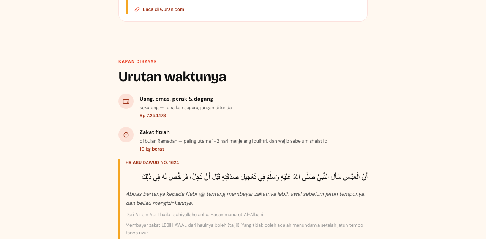

### Dua dasar hukum, dipilih pemakai

Bawaannya nash murni. Menyalakan "+ Hukum Indonesia" **mengubah angka sungguhan** — zakat
penghasilan (Fatwa MUI 3/2003) ikut dihitung, fitrah boleh dikonversi uang, catatan
BAZNAS/BSZ/pajak muncul — dan kotak "Apa yang berubah" menunjukkan deltanya, angka per
angka. Pemakai melihat persis apa yang ditambahkan fatwa di atas nash.

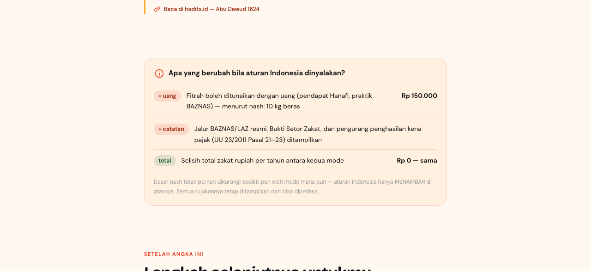

### Langkah selanjutnya

Angka saja belum menyelesaikan urusan. Checklist menyesuaikan hasil: niat, memilih amil
resmi atau menyalurkan langsung, bukti setor zakat untuk pengurang pajak, sampai pengingat
haul tahun depan.

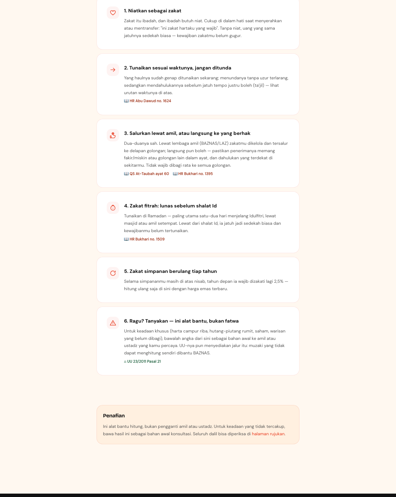

### Halaman rujukan

Seluruh ayat dan hadits yang dipakai — utuh, dengan teks Arab, terjemahan sehari-hari,
derajat, dan tautan sumber — plus metodologi, titik khilaf yang diambil, aturan hukum
Indonesia, dan glosarium.

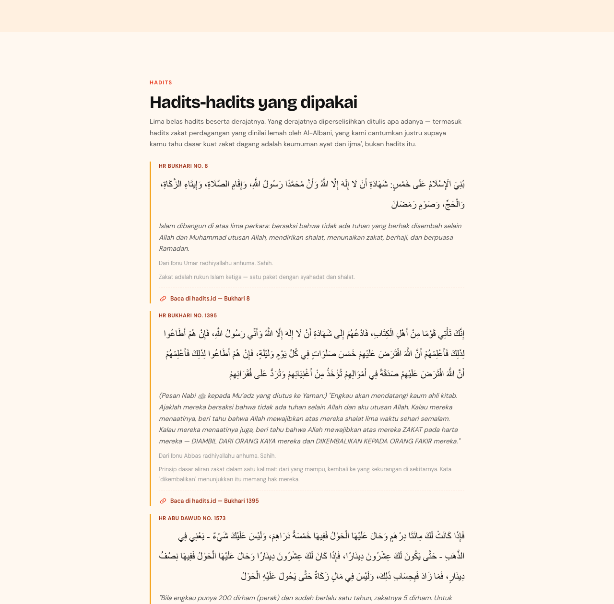

### Mobile

Dirancang mobile-first — inilah tampilan yang dipakai sebagian besar pengunjung.

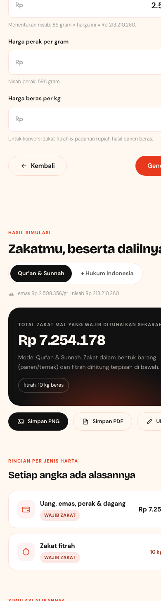

### Uji mesin zakat

`tests.html` menjalankan 85 kasus yang jawabannya baku dari nash dan tabel kitab fiqh.
Kalau ada satu saja yang merah, hasil kalkulator tidak boleh dipercaya.

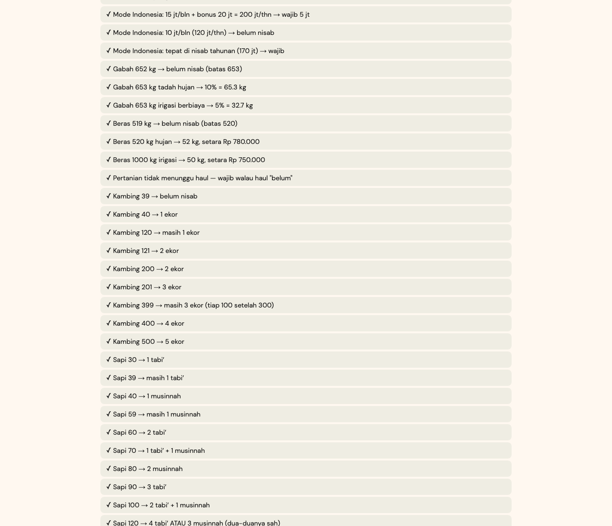

---

## Menjalankan

Tidak ada build step, tidak ada dependency, tidak ada npm.

```bash
python3 -m http.server 8124
```

Lalu buka <http://localhost:8124>. Untuk produksi, unggah seluruh folder ini apa adanya ke
hosting statis mana pun (GitHub Pages, Netlify, Vercel, cPanel).

`hitung.html?contoh=1` memuat kasus contoh langsung jadi — berguna untuk menunjukkan
hasilnya ke orang tanpa menyuruhnya mengetik dulu.

---

## Struktur

```
index.html              Halaman utama + animasi demo
hitung.html             Wizard isian → hasil → export
rujukan.html            Appendix — seluruh dalil, metodologi, titik khilaf
tests.html              Penguji mesin zakat — buka di browser

css/
  tokens.css            Salinan verbatim dari flavida-design-system
  base.css              Reset, nav, footer, tombol, kartu (dari waris)
  app.css               Gaya waris + blok khusus zakat (meter, aliran, asnaf…)
  print.css             Tata letak cetak / Simpan sebagai PDF

js/zakat/               Mesin perhitungan — murni, tanpa sentuhan DOM
  const.js              SEMUA angka baku di satu berkas, dengan id dalilnya
  uang.js               Kelompok simpanan: uang+emas+perak+dagang, nisab, haul
  dagang.js             Harta dagang bersih (barang + kas + piutang − hutang)
  penghasilan.js        Mode Indonesia: Fatwa MUI 3/2003; mode nash: penjelasan
  tani.js               5 wasaq; 10% hujan / 5% irigasi; dibayar saat panen
  ternak.js             Tabel surat Abu Bakar & hadits Mu'adz + pencari kombinasi
  rikaz.js              20% seketika
  fitrah.js             1 sha' (2,5 kg) per jiwa
  solve.js              Orkestrator: masukan + mode → hasil lengkap

js/
  dalil.js              Dataset ayat & hadits (statis — dianalisa sekali)
  hukum-id.js           UU 23/2011, PP 14/2014, Fatwa MUI, UU Cagar Budaya
  harga.js              Harga emas/perak dari API publik + nilai bawaan
  advice.js             Langkah selanjutnya untuk muzakki
  export.js             PNG (canvas) & PDF (dialog cetak) — tanpa pustaka
  ui-*.js               Lapisan tampilan
  tests.js              85 kasus uji
```

## Mesin: semua angka syariat di satu berkas

`js/zakat/const.js` memuat SELURUH angka baku — nisab, kadar, tabel ternak, konversi —
supaya bisa diperiksa sekali baca oleh orang yang tidak bisa membaca kode sekalipun.
Logika di modul lain tidak menyimpan angka syariat apa pun. Harga pasar (emas, perak,
beras) sengaja tidak pernah ada di berkas itu: ia bukan angka syariat, jadi ia selalu
input.

Tabel ternak untuk jumlah besar tidak di-hardcode baris per baris: kombinasinya dicari
dengan memaksimalkan cakupan blok (sapi 30/40; unta >120 blok 40/50) — cara ini
menghasilkan tabel yang sama persis dengan kitab fiqh, termasuk kasus dua jawaban sah
seperti 120 sapi (4 tabi' *atau* 3 musinnah) dan 200 unta (5 bintu labun *atau* 4
hiqqah), dan seluruh batas pergantiannya diuji di `tests.js`.

Mesin tidak menyentuh DOM sama sekali, jadi bisa diuji terpisah dan dipakai ulang.

## Dua dasar hukum, satu prinsip

Halaman hasil menjalankan mesin **dua kali** — mode "Qur'an & Sunnah" dan mode "+ Hukum
Indonesia" — lalu menampilkan salah satunya sesuai saklar dan menghitung selisihnya untuk
kotak "Apa yang berubah".

| | Qur'an & Sunnah | + Hukum Indonesia |
|---|---|---|
| Zakat penghasilan | Tidak dihitung tersendiri — gaji yang mengendap ikut zakat simpanan (nisab + haul) | 2,5% dari penghasilan bruto, nisab 85 gr emas/tahun (Fatwa MUI 3/2003) |
| Zakat fitrah | Beras 2,5 kg/jiwa | + konversi rupiah (pendapat Hanafi, praktik BAZNAS) |
| Catatan lembaga | Amil / langsung ke asnaf | + BAZNAS/LAZ berizin, Bukti Setor Zakat, pengurang penghasilan kena pajak (UU 23/2011 Pasal 21–23) |

Prinsipnya: **aturan Indonesia hanya menambah di atas nash, tidak pernah mengurangi** —
dan setiap tambahan diberi label beserta sumbernya.

### Ayat ditampilkan utuh, ruasnya disorot

Aturan yang sama dengan waris: **ayat tidak pernah dipenggal.** QS At-Taubah 60 memuat
delapan golongan dalam satu ayat; seluruh ayat selalu ditampilkan, lalu ruas golongan
yang sedang dibaca disorot dan sisanya dipudarkan. Ayat disimpan sebagai deretan ruas di
`js/dalil.js`, dan teks utuhnya diturunkan dari gabungan ruas itu — tidak mungkin ada dua
versi teks yang berbeda. Test suite menjaga setiap id dalil yang dirujuk mesin benar-benar
ada, dan setiap golongan asnaf menunjuk ruas yang ada di dalam ayatnya.

### Titik khilaf tidak disembunyikan

Pada titik yang ulama berbeda pendapat, kalkulator memakai **mazhab Syafi'i dan praktik
BAZNAS/Kemenag**, lalu menuliskan pendapat lain di tempat yang sama — sering lengkap
dengan angkanya:

1. **Nisab uang** di-qiyas-kan ke emas (BAZNAS); catatan pendapat nisab perak muncul
   beserta nominalnya bila relevan. Perak fisik ≥ 595 gram tetap wajib menurut nisabnya
   sendiri.
2. **Hutang jatuh tempo dekat** mengurangi harta zakat (jumhur); pendapat Syafi'iyah yang
   tidak mengurangkan dicatat.
3. **Perhiasan yang dipakai** tidak wajib (Syafi'i) — ada centang untuk mengikutkan
   (Hanafi, lebih hati-hati).
4. **Zakat penghasilan** hanya di mode Indonesia, karena dasarnya fatwa/qiyas, bukan nash.
5. **Fitrah dengan uang** hanya di mode Indonesia (Hanafi/BAZNAS).
6. **Ternak kandang** tidak wajib zakat ternak (jumhur, syarat sa'imah); pendapat Maliki
   dicatat. Ternak dagang diarahkan ke zakat perdagangan.

## Sumber & verifikasi kutipan

Setiap kutipan sudah dicocokkan satu per satu dengan [hadits.id](https://www.hadits.id)
dan [Quran.com](https://quran.com) (Agustus 2026), dan tiap entri menyimpan `tautan` ke
sumbernya supaya pembaca bisa memeriksa sendiri. Derajat hadits ditulis apa adanya
mengikuti penilaian di sumber — termasuk hadits zakat dagang (Abu Dawud 1562) yang
dinilai *dhaif* oleh Al-Albani: dicantumkan justru supaya jelas bahwa pijakan kuat zakat
dagang adalah keumuman QS Al-Baqarah 267 dan ijma'.

Teks pasal UU diverifikasi lewat basis data peraturan
([pasal.id](https://pasal.id/peraturan/uu/uu-no-23-tahun-2011)), bukan dari ingatan.

Catatan penting kalau menambah dalil: **nomor hadits berbeda antar penerbit.** Selalu
sertakan tautan ke sumbernya, jangan cukup nomor.

---

## Menguji

Buka <http://localhost:8124/tests.html>. Semua kasus harus hijau.

Bisa juga dari terminal:

```bash
node -e "['zakat/const','zakat/dagang','zakat/uang','zakat/penghasilan','zakat/tani','zakat/ternak','zakat/rikaz','zakat/fitrah','zakat/solve','dalil','tests'].forEach(m=>require('./js/'+m+'.js'));const h=Tests.jalankan();const g=h.filter(x=>!x.lulus);g.forEach(x=>console.log('GAGAL',x.nama,x.pesan));console.log((h.length-g.length)+'/'+h.length+' lulus')"
```

85 kasus, mencakup: seluruh batas pergantian tabel ternak (39/40/120/121 kambing, 29/30
sapi, kombinasi 70/100/120 sapi dan 121/130/150/200 unta), batas nisab tepat
(84,9 vs 85 gram; 652 vs 653 kg), haul dan tanggal jatuh temponya, hutang melebihi harta,
penggabungan uang+emas+dagang, delta kedua mode, fitrah, rikaz, dan pemeriksaan bahwa
setiap dalil yang dirujuk mesin benar-benar ada di dataset.

## Yang TIDAK dihitung

Sengaja tidak ditebak, karena butuh penilaian manusia. Untuk kasus berikut website
mengarahkan ke amil atau ustadz, dengan angka dari sini sebagai bahan awal:

- Saham, kripto, dan properti yang disewakan (ikhtilaf kontemporer)
- Zakat badan usaha formal (perusahaan)
- Hasil tambang yang diusahakan (ma'din)
- Harta bercampur riba yang perlu dibersihkan dulu
- Kalender hijriah presisi — haul dihitung ±354 hari sebagai perkiraan

## Privasi

Angka harta pemakai **tidak pernah keluar dari perangkatnya**. Tidak ada `localStorage`,
`sessionStorage`, cookie, maupun analitik. Permintaan jaringan hanya tiga, semuanya tanpa
membawa data pemakai:

1. Google Fonts (bisa di-self-host, ubah `@import` di `css/tokens.css`)
2. `api.gold-api.com` — harga emas & perak dunia (GET polos)
3. `open.er-api.com` — kurs USD→IDR (GET polos)

Kalau jaringan mati atau API tumbang, situs tetap berfungsi penuh memakai nilai bawaan di
`js/harga.js`, dan semua kolom harga selalu bisa diubah tangan. Export PNG digambar
langsung ke `<canvas>`, export PDF lewat dialog cetak browser — keduanya tanpa pustaka
pihak ketiga dan tanpa mengirim apa pun ke luar.

---

## Sebelum dipublikasikan

**`js/dalil.js` dan `rujukan.html` perlu diperiksa satu kali oleh ustadz yang kompeten di
bidang fiqh zakat** — teks Arab, terjemahan, nomor hadits, dan derajatnya. Logika
perhitungan bisa dibuktikan dengan test suite; keabsahan kutipan tidak bisa, dan ini
menyangkut hukum agama. Nilai bawaan harga di `js/harga.js` juga perlu ditinjau berkala.

---

## Berkontribusi

Alat ini menyangkut rukun Islam dan harta, jadi kodenya sengaja dibuka supaya bisa
diperiksa siapa pun — bukan untuk dipercaya begitu saja.

**Yang paling dibutuhkan:**

1. **Koreksi dalil** dari yang paham fiqh zakat — nomor hadits, derajat, terjemahan, atau
   kutipan yang keliru di `js/dalil.js` dan `rujukan.html`. Ini yang paling berharga.
2. **Kasus uji baru** dari kitab fiqh atau praktik amil. Tambahkan ke `js/tests.js`
   beserta jawaban bakunya dan sebutkan sumbernya.
3. **Laporan kekeliruan hitungan** — sertakan isian lengkapnya supaya bisa direproduksi.
4. **Kasus yang belum ditangani** — saham, ma'din, zakat perusahaan — beserta rujukan
   pendapat ulamanya.

Tidak perlu bisa ngoding. Buka *Issues* dan tulis dengan bahasa biasa — yang diperlukan
ilmunya, bukan kodenya:

- **GitHub Issues** — <https://github.com/arnantoakbar/zakat/issues>
- **Email** — <hello@flavida.co>
- **X** — [@FlavidaID](https://x.com/FlavidaID)

**Sebelum mengirim perubahan pada mesin:** jalankan test suite dan pastikan semua kasus
tetap lulus. Kalau mengubah perilaku hitungan, tambahkan kasus uji yang membuktikan
perubahannya benar.

**Catatan versi aset:** rujukan css dan js memakai penanda `?v=N`. Naikkan angkanya setiap
kali merilis perubahan, supaya pengunjung lama tidak mendapat berkas basi dari cache.

---

## Lisensi & aset merek

Berkas di `assets/` (bloom mark dan maskot Flav) adalah aset merek **Flavida** dan tidak
dimaksudkan untuk dipakai ulang di luar proyek ini. Kalau kamu ingin memakai kode
kalkulator zakatnya, ganti dulu aset dan penamaannya.

Belum ada berkas LICENSE — artinya hak cipta masih sepenuhnya pada pemilik repositori.

## Penafian

Ini alat bantu hitung, **bukan sumber utama dan bukan fatwa**. Verifikasi hasilnya kepada
amil atau ustadz terdekat, terutama untuk keadaan yang tidak tercakup. Isi `js/dalil.js`
dan `rujukan.html` perlu diperiksa satu kali oleh ahli fiqh zakat sebelum situs
dipublikasikan luas.
